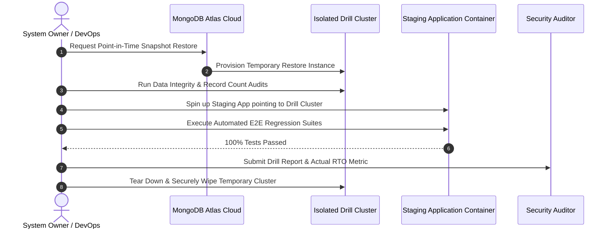

# Security Operations & Deployment Runbook (SECURITY_OPERATIONS.md)

**Project:** Telangana State Inter-District Yogasana Sports Championship Portal  
**Primary Domain:** `https://telanganayoga.org.in`  
**Hosting Platforms:** Vercel (Edge Compute & Serverless Engine), MongoDB Atlas (Document Store), Razorpay (Payment Processing), Google reCAPTCHA Enterprise (Bot Mitigation)  
**Classification:** Standard Operating Procedures (SOP) & Security Compliance Policy  
**Effective Date:** October 2026  
**Audience:** System Owners, DevOps Engineers, Platform Administrators, Scrutiny Officers

---

## 1. Executive Summary & Policy Distinction

This document establishes the deployment security architecture, identity lifecycle standards, console dashboard requirements, and disaster recovery procedures for the Telangana Yogasana Sports Championship Portal.

### Verification Status Distinction

To maintain technical integrity and audit compliance, this runbook strictly differentiates between three operational states:

1. **Code-Enforced Mechanisms:** Implemented directly in repository code and verified via automated test suites (e.g. `originGuard`, Helmet headers, safe HTTP redirect, input sanitization).
2. **Documented Operational Procedures (SOP):** Formalized human workflows (e.g. employee onboarding/offboarding, quarterly restore drills, emergency key rotation).
3. **Pending Dashboard Verification (Owner Actions):** Platform settings that cannot be configured or verified from the codebase and **must be verified and enabled by an account owner directly within platform dashboards** (`[STATUS: PENDING OWNER DASHBOARD VERIFICATION]`).

> [!IMPORTANT]
> **Zero-Credential Policy:** Under no circumstances should plain-text passwords, recovery keys, JWT secrets, database connection strings, or API private tokens be committed to Git repositories or transmitted over unencrypted chat/email.

---

## 2. Deployment Security Configuration Review

### 2.1. Vercel Response Headers Configuration vs `public/_headers`

- **`public/_headers` Evaluation:**  
  The `public/_headers` file generated during builds is an artifact format designed exclusively for **Cloudflare Pages and Netlify**. **Vercel does NOT parse or apply `public/_headers` files.**
- **Supported Vercel Configuration:**  
  On Vercel, production HTTP response headers must be specified in [`vercel.json`](vercel.json) (under the `"headers"` block) or dynamically injected via Express middleware ([`server.js`](server.js)).
- **Duplicate & Conflicting Headers Audit:**
  - *Previous Framing Conflict:* Previously, [`server.js`](server.js) set `frameAncestors: ["'none'"]` in CSP while [`vercel.json`](vercel.json) specified `X-Frame-Options: SAMEORIGIN`. This broke the embedded PDF proof preview modal in [`templates/dashboard.html`](templates/dashboard.html). Both layers have now been reconciled to allow same-origin framing:
    - Express CSP: `frame-ancestors 'self'`
    - Express / Vercel: `X-Frame-Options: SAMEORIGIN`
  - *Duplication Management:* Express (via Helmet) acts as the primary runtime authority for all rewritten routes (`/(.*)` -> `/api/index.js`). [`vercel.json`](vercel.json) applies matching fallback headers at the edge without introducing conflicting directives.

---

### 2.2. HTTP-to-HTTPS Redirection & Host-Header Defense

1. **Edge-Level Redirection (Vercel Platform):**
   - Vercel automatically terminates SSL/TLS at the Anycast edge and issues permanent `308 Moved Permanently` redirects for all inbound plain-text `http://` traffic to `https://`.
2. **Application-Level Redirection Behind Proxy ([`server.js`](server.js)):**
   - The Express application runs behind reverse proxy with `app.set('trust proxy', 1)`.
   - To defend against **Host-Header Injection and Open Redirect attacks**, the production HTTP-to-HTTPS redirection middleware validates the incoming host against an explicit allowlist and sanitizes the requested URL path:
     ```javascript
     const CANONICAL_HOST = 'telanganayoga.org.in';
     const ALLOWED_REDIRECT_HOSTS = new Set([
       'telanganayoga.org.in',
       'www.telanganayoga.org.in',
       'telangana-yogasan-portal.vercel.app'
     ]);
     ```
   - If `req.headers.host` is unrecognized or spoofed (e.g. `Host: evil.com`), the redirect targets the fixed canonical origin `https://telanganayoga.org.in`.
   - The path is validated to reject scheme-relative or backslash paths (e.g. `//evil.com` or `/\evil.com`), preventing open-redirect chaining.

---

### 2.3. HSTS Scope & Subdomain / Preload Prerequisites

In [`server.js`](server.js) and [`vercel.json`](vercel.json), HTTP Strict Transport Security is scoped as:
```http
Strict-Transport-Security: max-age=31536000
```

> [!WARNING]
> **Strict Prerequisites for `includeSubDomains` and `preload`:**  
> The directives `includeSubDomains` and `preload` are **intentionally omitted** from production defaults. They must NOT be enabled until the following conditions are confirmed by the domain owner:
> 1. **Complete DNS Audit:** Every existing and planned DNS record under `*.telanganayoga.org.in` (including mail, portal, staging, and legacy records) must possess active, auto-renewing TLS certificates.
> 2. **Zero Plain-HTTP Services:** No internal or third-party subdomains may rely on plain HTTP.
> 3. **Irreversibility of Preload:** Submission to `hstspreload.org` permanently bakes the HTTPS requirement into major browser releases (Chrome, Firefox, Safari, Edge). Revocation takes months.
> 4. **Staged Rollout Plan:** If preloading is desired in the future, the owner must first test with `max-age=300`, then `max-age=86400`, before setting 1 year with `includeSubDomains` and submitting to the preload list.

---

### 2.4. `originGuard` & Environment-Specific Origin Allowlist Enforcement

The [`originGuard`](middleware/sanitize.js) middleware defends state-changing requests (`POST`, `PUT`, `PATCH`, `DELETE`) against CSRF, Host-header spoofing, and referrer-stripping bypasses using environment-segregated allowlists:

1. **Exact, Owned Production Origins Only:**
   In production (`NODE_ENV=production` or `VERCEL_ENV=production`), wildcard preview origins and unconfirmed legacy domains are strictly barred. The production allowlist is restricted strictly to confirmed, owned production hostnames:
   - `telanganayoga.org.in` (Primary Apex Production Domain)
   - `www.telanganayoga.org.in` (Canonical www Subdomain)
   - `telangana-yogasan-portal.vercel.app` (Exact Vercel Production Project Alias)
   - Configured `SITE_URL` (if set)
2. **Environment-Restricted Preview Origins (`VERCEL_ENV === 'preview'`):**
   Vercel preview origins are **never permitted in production**. They are strictly activated only when running inside a verified preview deployment context (`process.env.VERCEL_ENV === 'preview'`):
   - Exact ephemeral deployment domain: `process.env.VERCEL_URL` / `process.env.VERCEL_BRANCH_URL`
   - Tightly controlled pattern restricted exclusively to this project's team namespace: `/^telangana-yogasan-portal-[a-z0-9_-]+\.vercel\.app$/i`
   - Foreign, attacker, or unrelated Vercel preview deployments (e.g. `*.vercel.app` for other projects) are rejected with `403 Forbidden`.
3. **Purged Legacy Domains:**
   Unconfirmed legacy domains (such as `telanganayoga.org` and `www.telanganayoga.org`) have been completely purged from runtime allowlists.
4. **Attacker-Controlled Host Defense:**
   The `Host` request header is independently validated against the active environment allowlist. An attacker cannot bypass validation by sending a matching attacker `Host` and `Origin` (e.g. `Host: evil.com` + `Origin: https://evil.com`).
5. **Missing Origin/Referer Defense:**
   - If a request has browser markers (`Sec-Fetch-Site`, `Sec-Fetch-Mode`) or is authenticated with session cookies (`req.cookies.token`), both `Origin` and `Referer` missing results in `403 Forbidden`.
   - Cross-site fetch metadata (`Sec-Fetch-Site: cross-site`) is blocked immediately.

---

### 2.5. Security Headers Inventory

```http
Strict-Transport-Security: max-age=31536000
Content-Security-Policy: default-src 'self'; script-src 'self' 'unsafe-inline' https://checkout.razorpay.com https://www.google.com/recaptcha/ https://www.gstatic.com/recaptcha/; style-src 'self' 'unsafe-inline' https://fonts.googleapis.com; imgSrc 'self' data: blob: https:; fontSrc 'self' data: https://fonts.gstatic.com; connectSrc 'self' https://api.razorpay.com https://www.google.com/recaptcha/ https://recaptchaenterprise.googleapis.com; frameSrc 'self' https://api.razorpay.com https://www.google.com/recaptcha/; object-src 'none'; base-uri 'self'; form-action 'self'; frame-ancestors 'self'; upgrade-insecure-requests;
X-Content-Type-Options: nosniff
X-Frame-Options: SAMEORIGIN
Referrer-Policy: strict-origin-when-cross-origin
Permissions-Policy: camera=(), microphone=(), geolocation=(), payment=(self "https://api.razorpay.com")
Cross-Origin-Resource-Policy: same-origin
Cross-Origin-Embedder-Policy: false
```

---

## 3. Identity & Access Management (IAM)

### 3.1. Individual Account Policy (Strict Zero-Shared-Logins)

- **Mandatory Individual Attribution:** Generic or shared accounts (e.g., `admin@telanganayoga.org.in`, `team`, `secretary_shared`) are strictly prohibited for system administration and operational scrutiny.
- **Dedicated Named Accounts:** Every engineer, district secretary, and scrutiny committee officer must be provisioned with an individual, named account matching their institutional identity (e.g., `firstname.lastname@telanganayoga.org.in`).
- **Role-Based Access Control (RBAC) Matrix:**

| Role | Access Scope | Interface | Permitted Actions |
| :--- | :--- | :--- | :--- |
| **System Owner** | Complete infrastructure | GitHub, Vercel, Atlas, Razorpay | Account lifecycle, billing, DNS, production secrets |
| **Lead Developer / DevOps** | Repository & Preview | GitHub (`Write`), Vercel (`Member`) | Code authoring, PR reviews, CI deployment debugging |
| **Super Admin** | State-wide Championship Portal | Application Admin Dashboard | All 33 districts athlete verification, notice authoring, schedule |
| **District Secretary** | Scoped District Jurisdiction | Application Secretary Dashboard | Nominations for assigned district only, admit card lookups |

---

### 3.2. Multi-Factor Authentication (2FA / MFA) Standards

- **Mandatory 2FA Enforcement:** Two-factor authentication is mandatory for all administrative consoles (GitHub Organization, Vercel Team, MongoDB Atlas Organization, Razorpay Merchant Portal, Google Cloud Console).
- **Approved Authentication Factors (In Priority Order):**
  1. **FIDO2 / WebAuthn Hardware Security Keys:** YubiKey 5 Series, Titan Security Keys (Recommended for System Owners).
  2. **Time-Based One-Time Password (TOTP):** Enterprise password managers (1Password, Bitwarden) or authenticator apps (Google Authenticator, Microsoft Authenticator).
- **Prohibited Factors:** SMS and voice-call OTP verification are prohibited for primary console logins due to SIM-swapping vulnerabilities.
- **Emergency Recovery Codes:**
  - Recovery codes must be printed or written on physical media and stored in an access-controlled, fireproof safe.
  - Recovery codes must **never** be stored in cloud drives, git repositories, or unencrypted text files.

---

### 3.3. Password-Manager & Credential Standards

- **Approved Password Managers:** All administrative and technical personnel must generate and store credentials using an enterprise or vetted password manager (1Password, Bitwarden, or KeePassXC).
- **Password Complexity Rules:**
  - Minimum length: **20 characters**.
  - Composition: Random combination of uppercase, lowercase, numbers, and special characters.
  - Frequency: Generated uniquely per platform; zero cross-service password reuse.
- **API Token Security:**
  - Personal Access Tokens (GitHub PATs, Atlas API keys) must be created with explicit expiration dates (maximum 90 days) and minimum necessary scopes.

---

## 4. Personnel Onboarding & Offboarding SOP

```mermaid
flowchart TD
    subgraph Onboarding["Onboarding Workflow"]
        O1["HR / Committee Approval"] --> O2["Provision Individual Email"]
        O2 --> O3["Enforce Password Manager & 2FA Setup"]
        O3 --> O4["Grant Least-Privilege Console Access"]
        O4 --> O5["Sign Acceptable Use & Security SOP"]
    end

    subgraph Offboarding["Offboarding Workflow (Within 1 Hour)"]
        F1["Notification of Separation"] --> F2["Revoke Console Accounts (GitHub, Vercel, Atlas, Razorpay)"]
        F2 --> F3["Deactivate Application User in DB"]
        F3 --> F4["Revoke Personal Access Tokens & Sessions"]
        F4 --> F5["Rotate Shared Production Secrets (If Exposed)"]
    end
```



### 4.1. Onboarding Standard Operating Procedure

1. **Identity Verification & Email Provisioning:** Confirm government identity and issue individual institutional email address.
2. **Security Tooling Setup:** Require installation of approved password manager and configuration of TOTP/hardware token.
3. **Account Provisioning:**
   - **GitHub:** Invite individual GitHub account to organization; assign to developer team with `Read` or `Triage` permissions.
   - **Vercel:** Invite as `Member` (Developer); restrict Production environment variable view permissions.
   - **MongoDB Atlas:** Add user with read-only staging access or project-specific developer role; restrict IP whitelist access.
   - **Application Portal:** Create database record in `Secretaries` or `Users` with verified `district` assignment and `status: 'ACTIVE'`.
4. **Code Signing:** Instruct engineer to configure GPG commit signing on their local workstation.

### 4.2. Offboarding Standard Operating Procedure (Order of Operations)

When an engineer, administrator, or district secretary departs the organization, the System Owner must execute the following de-provisioning sequence **within 60 minutes**:

1. **Step 1: Application Portal Access Deactivation:**
   - Execute administrative API call or direct DB update: Set athlete scrutiny and secretary status to `INACTIVE`.
   - Invalidate all active JWT tokens for the user ID.
2. **Step 2: Platform Console Access Revocation:**
   - **GitHub:** Remove account from Organization and all repository teams.
   - **Vercel:** Remove user from Vercel Team.
   - **MongoDB Atlas:** Delete database user credentials and revoke Organization membership.
   - **Razorpay:** Revoke Merchant Portal access.
3. **Step 3: SSH & Deployment Key Purge:**
   - Remove any public SSH keys or personal access tokens associated with the individual.
4. **Step 4: Secret Rotation Assessment:**
   - If the departed member possessed access to Production environment secrets (`JWT_SECRET`, `MONGO_URI`, `RAZORPAY_KEY_SECRET`), trigger an immediate **Emergency Secret Rotation Cycle** as detailed in Section 8.

---

## 5. Console Dashboard Actions for System Owners

The following platform configuration actions **must be performed directly by the account owner in web dashboards**. They are tracked here as pending owner action.

### 5.1. GitHub Dashboard Actions

- `[OWNER ACTION: GITHUB - PENDING OWNER DASHBOARD VERIFICATION]` **Require 2FA for Organization:**
  - Navigate to **Organization Settings** -> **Security** -> **Authentication security**.
  - Check **Require two-factor authentication for everyone in the organization**.
- `[OWNER ACTION: GITHUB - PENDING OWNER DASHBOARD VERIFICATION]` **Branch Protection on `master`:**
  - Navigate to **Repository Settings** -> **Branches** -> **Branch protection rules** -> `master`.
  - Check **Require a pull request before merging** (minimum 1 approving review).
  - Check **Require status checks to pass before merging** (`WCAG Accessibility`, `Integration Tests`, `Security Tests`).
  - Check **Require signed commits**.
  - Check **Do not allow bypassing the above settings**.
- `[OWNER ACTION: GITHUB - PENDING OWNER DASHBOARD VERIFICATION]` **Secret Scanning & Dependabot:**
  - Navigate to **Repository Settings** -> **Code security and analysis**.
  - Enable **Dependabot alerts**, **Dependabot security updates**, and **Secret scanning**.

---

### 5.2. Vercel Dashboard Actions

- `[OWNER ACTION: VERCEL - PENDING OWNER DASHBOARD VERIFICATION]` **Enforce Team Multi-Factor Authentication:**
  - Navigate to **Team Settings** -> **Security** -> **Two-Factor Authentication**.
  - Set enforcement to **Mandatory for all team members**.
- `[OWNER ACTION: VERCEL - PENDING OWNER DASHBOARD VERIFICATION]` **Restrict Production Environment Variables:**
  - Navigate to **Project Settings** -> **Environment Variables**.
  - For sensitive variables (`JWT_SECRET`, `MONGO_URI`, `RAZORPAY_KEY_SECRET`, `RECAPTCHA_API_KEY`):
    - Select **Production** only.
    - Check **Sensitive** (masks value from team members).
    - Under **Permissions**, restrict decryption access strictly to **Team Owners**.
- `[OWNER ACTION: VERCEL - PENDING OWNER DASHBOARD VERIFICATION]` **Custom Domain Verification & HTTPS Enforcement:**
  - Navigate to **Project Settings** -> **Domains**.
  - Verify `telanganayoga.org.in` status is **Valid Configuration**.
  - Ensure **Redirect to Apex** is enabled for `www.telanganayoga.org.in` -> `telanganayoga.org.in`.
- `[OWNER ACTION: VERCEL - PENDING OWNER DASHBOARD VERIFICATION]` **Deployment Protection for Previews:**
  - Navigate to **Project Settings** -> **Deployment Protection**.
  - Enable **Vercel Authentication** or **Password Protection** for Preview Deployments to prevent indexing of non-production environments.

> [!CAUTION]
> **Plan-Dependent Feature: Vercel Static Outbound IPs**  
> Vercel does **NOT** provide dedicated static outbound IP addresses on standard Hobby or Pro subscription plans. Serverless functions execute within dynamic AWS Lambda IP pools. Attempting to restrict Atlas Network Access to individual IPs will break database connectivity unless the organization utilizes **Vercel Secure Compute (Enterprise plan only)**, a self-hosted NAT proxy, or the official MongoDB Atlas Vercel Integration. This configuration is **plan-dependent pending owner dashboard and subscription verification**.

---

### 5.3. MongoDB Atlas Dashboard Actions

- `[OWNER ACTION: MONGODB ATLAS - PENDING OWNER DASHBOARD VERIFICATION]` **Organization Multi-Factor Authentication:**
  - Navigate to **Manage Organizations** -> **Security Settings** -> **Two-Factor Authentication**.
  - Toggle **Require Two-Factor Authentication (2FA)** for all project members.
- `[OWNER ACTION: MONGODB ATLAS - PENDING OWNER DASHBOARD VERIFICATION]` **Dedicated Least-Privilege Database Users:**
  - Navigate to **Security** -> **Database Access**.
  - Verify that the production application user (`yogasana_app_prod`) is granted strictly `readWrite` permissions on database `telangana_yoga`.
  - Do not use `atlasAdmin` or cluster-wide superuser roles for runtime application connections.
- `[OWNER ACTION: MONGODB ATLAS - PENDING OWNER DASHBOARD VERIFICATION]` **Network Access Review:**
  - Navigate to **Security** -> **Network Access** -> **IP Access List**.
  - Review network boundaries. If using Vercel without an Enterprise plan (no static IPs), configure secure certificate/credential access and review Atlas cluster authentication logs.

> [!CAUTION]
> **Plan-Dependent Feature: Atlas Continuous Cloud Backup & Point-in-Time Recovery (PITR)**  
> Continuous Cloud Backup with 72-hour oplog point-in-time recovery (PITR) is strictly available on **Atlas M10+ dedicated cluster tiers**. Shared/free tiers (M0, M2, M5) do not support continuous oplog PITR. This capability is **plan-dependent pending owner dashboard verification of cluster tier**.

---

### 5.4. Razorpay Dashboard Actions

- `[OWNER ACTION: RAZORPAY - PENDING OWNER DASHBOARD VERIFICATION]` **Enforce Two-Factor Authentication:**
  - Navigate to **Settings** -> **Account Settings** -> **Security**.
  - Activate mandatory 2FA on login.
- `[OWNER ACTION: RAZORPAY - PENDING OWNER DASHBOARD VERIFICATION]` **API Key Separation & Secret Cycling:**
  - Navigate to **Settings** -> **API Keys**.
  - Ensure **Live Mode** keys are used exclusively in production environment variables.
  - Ensure **Test Mode** keys are used in development/preview.
  - Never reveal or export keys via unencrypted channels.
- `[OWNER ACTION: RAZORPAY - PENDING OWNER DASHBOARD VERIFICATION]` **Lock Settlement Bank Account Changes:**
  - Navigate to **Settings** -> **Bank Account**.
  - Ensure change notifications and dual-authorization OTP verification are enabled for any settlement account modification.

---

## 6. Backup Retention & Disaster Recovery Procedures

### 6.1. Backup Architecture & Retention Schedules (Target Policy)

| Tier | Frequency | Retention Window | Storage Tier | Target RPO | Dependency |
| :--- | :--- | :--- | :--- | :--- | :--- |
| **Continuous Oplog** | Real-time stream | 72 hours (Point-in-Time) | Atlas Hot Storage | < 5 minutes | Requires Atlas M10+ Cluster |
| **Hourly Snapshots** | Every 60 minutes | 24 hours | Regional Snapshot | < 1 hour | Requires M10+ or Advanced Backup Plan |
| **Daily Snapshots** | Every 24 hours (02:00 IST) | 30 days | Regional Snapshot | < 24 hours | Standard Cloud Backup |
| **Weekly Snapshots** | Every Sunday | 90 days | Multi-Region Encrypted Archive | < 7 days | Standard Cloud Backup |
| **Annual Snapshot** | End of Tournament | 365 days (Historical Record) | Cold Encrypted Storage | N/A | Manual / Compliance Export |

> [!IMPORTANT]
> **Plan-Dependent Recovery Targets (Pending Live Drill Verification):**
> - **Recovery Point Objective (RPO):** The target of **< 5 minutes** is an operational goal that strictly requires an **Atlas M10+ cluster** with active continuous oplog backups. On lower tiers (M0/M2/M5), the actual RPO is limited to the scheduled snapshot interval (up to 24 hours).
> - **Recovery Time Objective (RTO):** The target of **< 120 minutes** is an operational Service Level Target (SLT) that must be validated during scheduled quarterly restore drills, not an automated guarantee.

### 6.2. Document Storage & Static Asset Backups

- Uploaded athlete passport photographs and date-of-birth proof certificates stored under `/uploads/` are synchronized daily to an encrypted off-site cloud storage bucket with versioning and immutable object locking (WORM: Write Once, Read Many) enabled for 90 days post-championship.

---

## 7. Quarterly Restore-Drill Standard Operating Procedure

To ensure backup viability and disaster readiness, the technical team must conduct a **Quarterly Restore Drill** every 90 days.



### 7.1. Step-by-Step Restore Drill Execution

1. **Pre-Drill Scheduling:** Notify association executives 48 hours prior to drill. Drills are performed on isolated staging infrastructure and never touch the live production cluster.
2. **Snapshot Selection:** Select an arbitrary point-in-time timestamp from 48 hours prior in the MongoDB Atlas console.
3. **Trigger Restore to New Cluster:**
   - In MongoDB Atlas: Select **Backup** -> **Restore**.
   - Choose **Restore to a New Cluster** (Cluster Name: `telangana-yoga-drill-YYYYMMDD`).
   - *Never select "Restore in place" on the production database!*
4. **Data Integrity Verification:**
   - Connect to the drill cluster using `mongosh` or administrative script.
   - Verify document counts match expected production values at snapshot time:
     ```javascript
     db.athletes.countDocuments();
     db.secretaries.countDocuments();
     db.competitions.countDocuments();
     db.notices.countDocuments();
     ```
   - Check cryptographic checksums and index health:
     ```javascript
     db.athletes.aggregate([{ $group: { _id: "$paymentDetails.status", count: { $sum: 1 } } }]);
     ```
5. **Application Functional Verification:**
   - Configure a local or preview container pointing `MONGO_URI` to the newly restored drill cluster.
   - Run the automated integration and end-to-end suites:
     ```bash
     npm test
     ```
   - Verify athlete search, admit card lookup, and admin login operate cleanly.
6. **Drill Documentation & Sign-off:**
   - Log drill start time, completion time, observed RTO, document counts, and discrepancies in the **Restore Drill Log Sheet** below.
7. **Cluster Teardown:**
   - Immediately terminate and delete `telangana-yoga-drill-YYYYMMDD` in MongoDB Atlas to avoid lingering data exposure and compute charges.

### 7.2. Restore Drill Log Sheet Template

```markdown
### Restore Drill Audit Record

- **Drill Date:** YYYY-MM-DD
- **Lead Operator:** [Full Name]
- **Auditor / Witness:** [Full Name]
- **Target Snapshot Timestamp:** YYYY-MM-DD HH:MM:SS UTC
- **Restore Trigger Time:** HH:MM:SS
- **Cluster Ready Time:** HH:MM:SS
- **Total Observed RTO:** XX minutes (Requirement: < 120 minutes)
- **Document Count Reconciliation:**
  - Athletes: [Count Matches Snapshot: YES / NO]
  - Competitions: [Count Matches Snapshot: YES / NO]
  - Payment Totals: [Reconciled: YES / NO]
- **Functional Verification Test Result:** [PASS / FAIL]
- **Sign-off:** ___________________________ (System Owner)
```

---

## 8. Incident Response & Emergency Secret Rotation

If any credential or key is accidentally disclosed or suspected of compromise, execute the **Emergency Rotation Protocol**:

1. **JWT Secret (`JWT_SECRET`):**
   - Generate new 64-character cryptographic secret:
     ```bash
     node -e "console.log(require('crypto').randomBytes(32).toString('hex'))"
     ```
   - Update in Vercel Project Settings (Production).
   - Trigger Vercel redeployment. (Note: Existing active user sessions will require re-login).
2. **MongoDB Connection String (`MONGO_URI`):**
   - In Atlas: Create new database user with fresh password.
   - Update `MONGO_URI` in Vercel environment variables.
   - Redeploy application.
   - In Atlas: Delete the old database user.
3. **Razorpay Secrets (`RAZORPAY_KEY_SECRET`):**
   - In Razorpay Dashboard: Generate new API Secret key (with old key grace period).
   - Update in Vercel environment variables.
   - Redeploy application and verify test payment.
   - Revoke old key in Razorpay dashboard.
